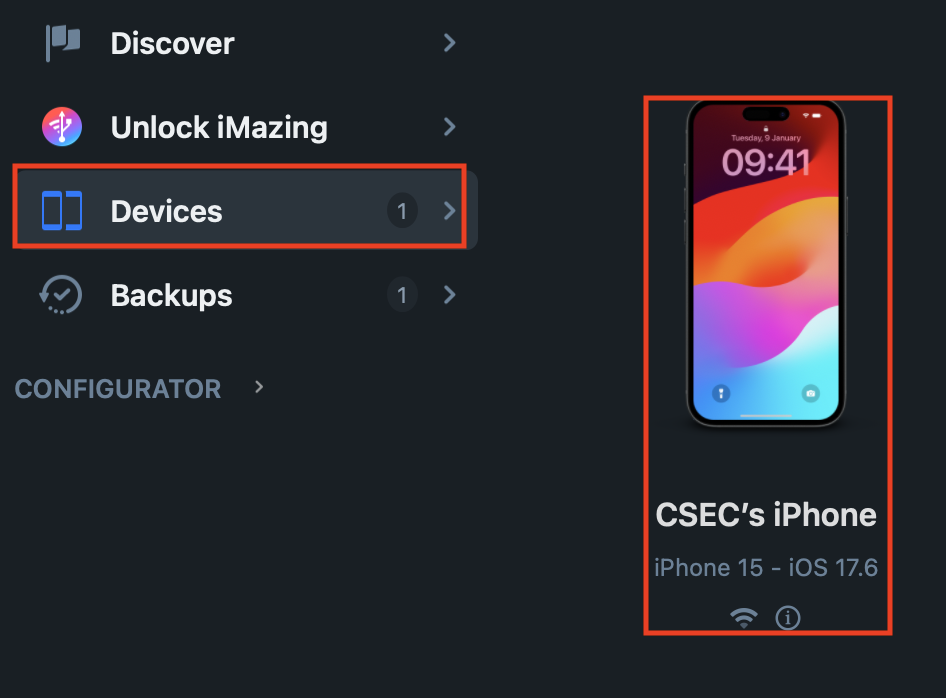
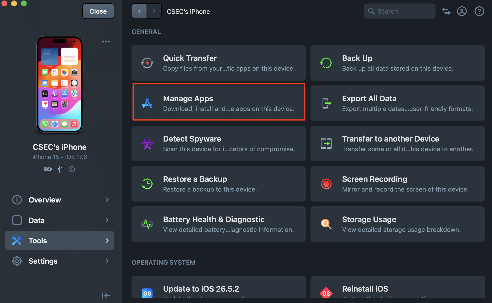
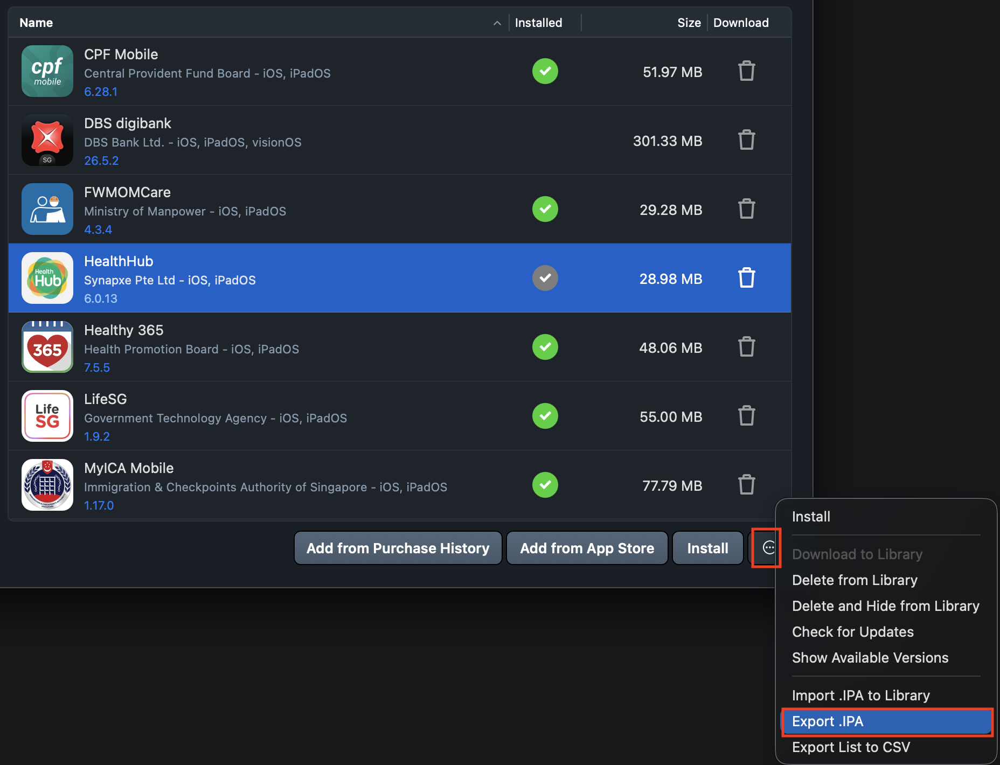

## ios-platform-feature-01

### Title

Retrieve an IPA via [iMazing](https://imazing.com/guides/how-to-manage-apps-without-itunes?utm_medium=app)

### Description

Retrieve an IPA is a feature that allows an IPA file to be obtained using [iMazing](https://imazing.com/guides/how-to-manage-apps-without-itunes?utm_medium=app) on macOS, enabling security testers to inspect the app's structure, configuration, permissions, and entitlements.

### Demonstration

#### 01. Prepare the environment

Set up the required environment with:
* A physical iPhone 15 running iOS 17.6
* A physical macOS workstation with iMazing
* A target app installed on the iPhone

#### 02. Provide access to app

Sign in to the same Apple ID on both the physical iOS device and the macOS workstation. This ensures iMazing can access the app licenses and deploy apps associated with the Apple ID.

#### 03. Trigger IPA download

Connect the iPhone to the macOS workstation and open iMazing. Select `Devices`, and then select the connected iPhone. This displays the apps and management options for the selected device.

*Screenshot shows the list of connected iPhones under `Devices`.*

#### 04. Install the IPA

On iMazing, install the app that you intend to export. This can be done through the `Manage Apps` section. `Manage Apps` lists the apps installed on the connected iPhone and provides access to the installation and export options. 

> Note: wait for the installation to complete before you continue.

*Screenshot shows the tools provided by iMazing.*

*Screenshot shows the `HealthHub` app selected for installation.*

#### 05. Save IPA

Select the More Options (`...`) button on the bottom right of iMazing and select `Export .IPA`. This creates an IPA file from the selected app package.

*Screenshot shows the menu option to export the app as an IPA file.*

Because the iOS platform provides IPA acquisition feature, your app is at risk of:
- [ios-platform-feature-01-risk-01](ios-platform-feature-01-risk-01.md)
- [ios-platform-feature-01-risk-02](ios-platform-feature-01-risk-02.md)
