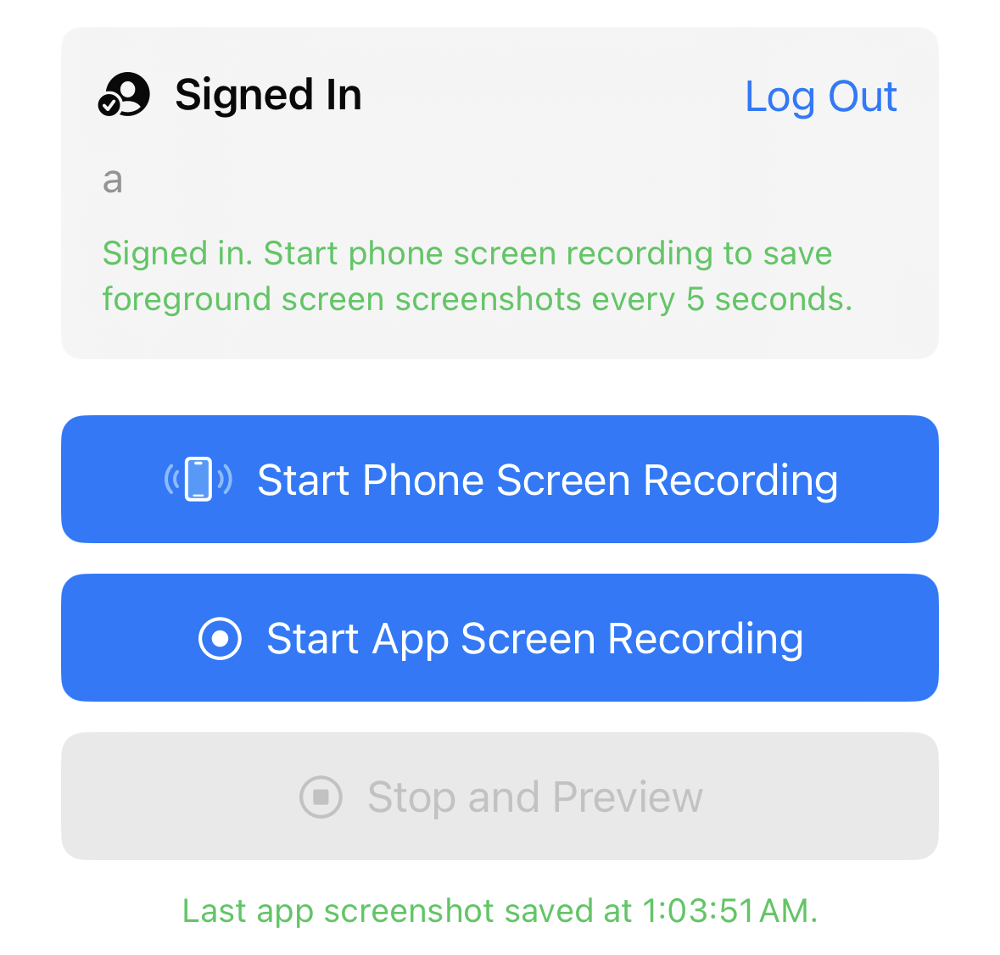
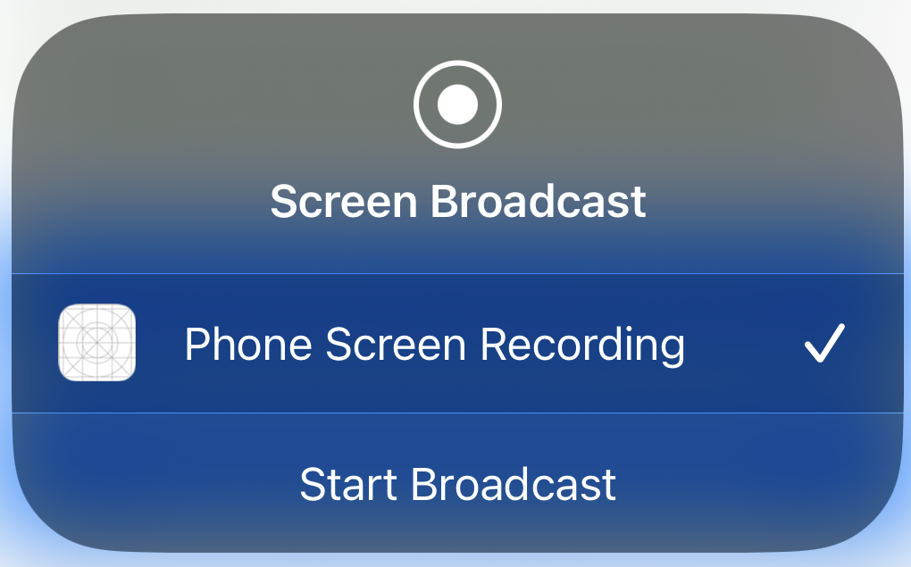
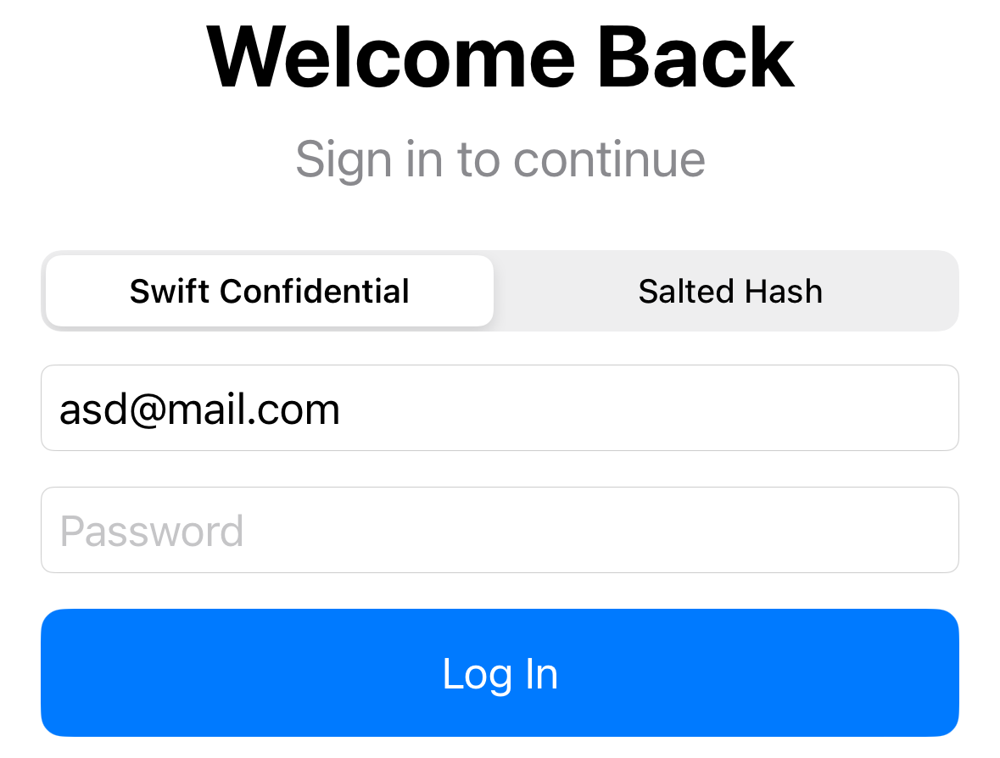
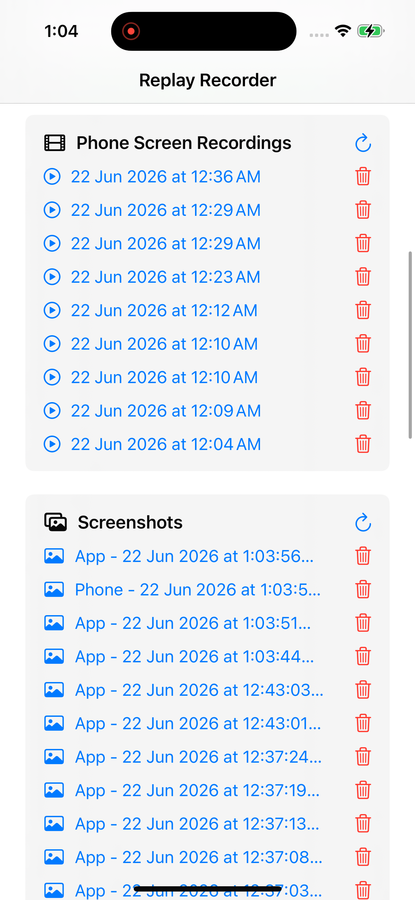

## ios-platform-feature-03-risk-01

### Title

Capture on-screen content

### Description

Capture on-screen content by recording the app display during an authorised screen recording session to collect sensitive information visible within the app (MITRE ATT&CK: ***Collection*** - TA0035).

### Demonstration
#### 01. Prepare the environment

Set up the required environment with:
* A physical iPhone 15 running iOS 17.6
* A physical macOS workstation with Xcode
* A target app installed on the iPhone

#### 02. Install screen recording app

Install the screen recording app on the iPhone. Use Xcode to open the [feature3-replay_consent_recorder](https://github.com/zhiyi-school/iosplaybook_sideload/tree/main/ScreenRecording) project, then build and run the app on the iPhone. 

``` swift
// Opens Apple's screen-recording consent picker
BroadcastPickerView(isEnabled: true, activationID: phoneRecordingRequestID)

// Receives screen frames from iOS and saves into file
override func processSampleBuffer(_ sampleBuffer: CMSampleBuffer, with sampleBufferType: RPSampleBufferType) {
    if sampleBufferType == .video {
        videoInput?.append(sampleBuffer)
    }
}
```

*Code block shows logic for screen recording function in an App.*

#### 03. Start screen recording

Tap `Start Phone Screen Recording`. When the `Screen Broadcast` prompt appears, select `Phone Screen Recording` and tap `Start Broadcast` to authorise and begin recording the whole screen. `Start App Screen Recording` records only the recorder app itself and cannot capture the target app.



*Screenshot shows the recorder app with the `Start Phone Screen Recording` button and the time the last screenshot was saved*



*Screenshot shows the system `Screen Broadcast` prompt*

#### 04. Reveal information in target app

Switch to the target app and enter or display information while the recording continues. This tests whether an authorised recording session from another malicious app can capture information displayed in the target app.

#### 05. Check for sensitive information

Stop the recording and review the recorded images and videos. Check whether the captured content includes sensitive information displayed in the target app.



*Screenshot shows a captured frame with the username visible and the password field blanked*



*Screenshot shows list of screen recording and screenshots taken by the malicious app*

Feature-03-Risk-01 control measures:

- [ios-platform-feature-03-risk-01-control-01](ios-platform-feature-03-risk-01-control-01.md)
