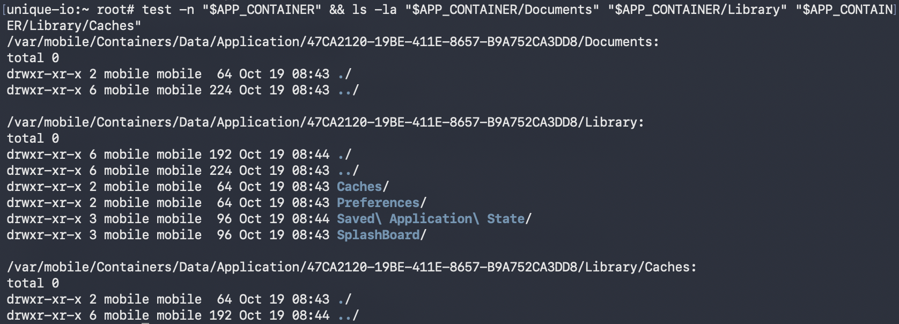
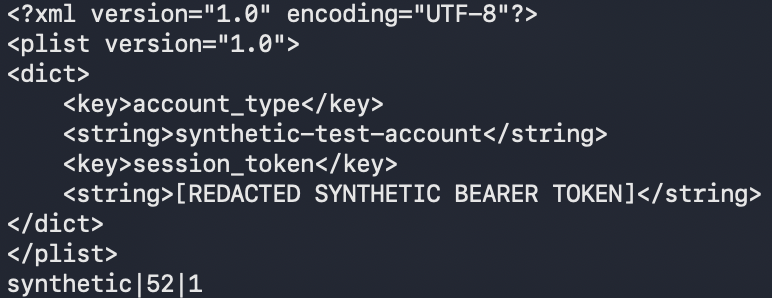

## ios-platform-feature-05-risk-01

### Title

Access app sandbox data

### Description

Access application sandbox data by using elevated privileges on a jailbroken device to read files stored inside the app's container (MITRE ATT&CK: ***Collection*** - TA0035).

A finding means sensitive data was recovered from the app's sandbox using root access. Running on a jailbroken device is a test prerequisite, not itself a vulnerability. The finding reflects what an attacker with elevated privileges could read, not a flaw in iOS sandboxing.

### Demonstration
#### 01. Prepare the environment

Set up the required environment with:
* A Corellium virtual iPhone running a jailbroken iOS 27.0.1 image
* An SSH client and a file transfer tool
* The target app installed on the Corellium device

#### 02. Create and boot the device

In the Corellium project, create a new device, select an iPhone model running iOS 27.0.1, and start it using the jailbroken image option so it boots with the standard restrictions removed. Creating and booting the device this way provides a controlled iOS environment with the elevated access used during testing.


*Screenshot shows creating an iPhone device and booting the jailbroken image in the Corellium project*

#### 03. Connect to the device

Connect to the device over the Corellium network and open an SSH session using the credentials shown in the device console. The connection provides a shell for running the test tooling.


*Screenshot shows an SSH session established to the device*

#### 04. Confirm elevated access

Run `id` in the SSH session and confirm the session has root privileges. Confirming elevated access establishes that the device is ready for the risks that follow.


*Screenshot shows the session running with root privileges*

#### 05. Locate the app container

Find the app's data container under `/var/mobile/Containers/Data/Application/` by matching the bundle identifier. Locating the correct container ensures the inspected files belong to the target app.

``` bash
find /var/mobile/Containers/Data/Application -iname '*.sqlite' 2>/dev/null
```

*Code block shows searching the data containers for stored databases*

#### 06. Inspect stored files

Review the `Documents`, `Library`, and `Caches` directories, including property lists, databases, and cached responses. Inspecting these locations shows what the app writes to disk during normal use.



*Screenshot shows the contents of the app's data container*

#### 07. Check for sensitive data

Examine the recovered files for sensitive information such as authentication tokens, personal data, or credentials held in plaintext. Finding such data in the container demonstrates the exposure. Do not retain the recovered values themselves as report evidence; record only the file location and the type of data observed.



*Screenshot shows a stored file containing sensitive values*

Feature-05-Risk-01 control measures:

- [ios-platform-feature-05-risk-01-control-01](ios-platform-feature-05-risk-01-control-01.md)

References:

- https://mas.owasp.org/MASTG/techniques/ios/MASTG-TECH-0053/
- https://attack.mitre.org/tactics/TA0035/
