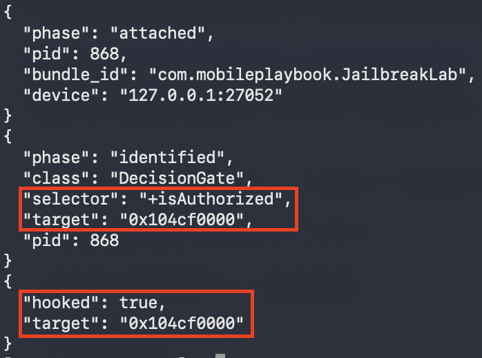
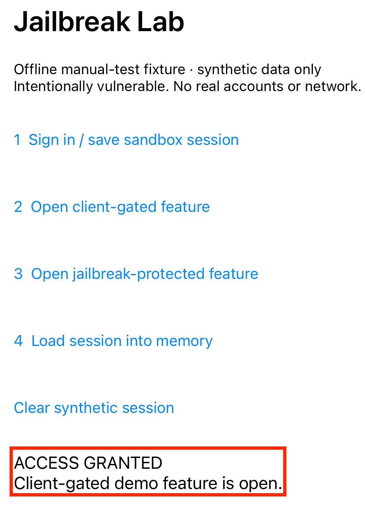

## ios-platform-feature-05-risk-02

### Title

Manipulate runtime decisions

### Description

Manipulate runtime decisions by attaching a dynamic instrumentation framework to the running app and altering security-critical logic in memory (MITRE ATT&CK: ***Defense Evasion*** - TA0030).

A finding means a client-side decision was changed at runtime without restarting the app. This shows the decision is enforced only on the device. Server-enforced decisions cannot be changed this way.

### Demonstration
#### 01. Prepare the environment

Set up the required environment with:
* A Corellium virtual iPhone running a jailbroken iOS 27.0.1 image, with the target app installed through the device's `Apps` tab
* A workstation with Frida installed
* A Frida server running on the Corellium device


For a reproducible workflow check, use the minimal offline Jailbreak Lab 1.0 fixture, bundle `com.mobileplaybook.JailbreakLab`, saved in iOS intake. It contains only the four deliberately vulnerable test behaviors and generates synthetic session data. These demonstrations validate the procedure rather than the security of a production app. The tested tools were Frida client 17.9.10, the existing Frida server 17.19.0 and objection 1.12.4. Record versions when repeating the test.

#### 02. Create and boot the device

Reuse an existing authorised jailbroken device when it already runs iOS 27.0.1. Confirm the project, device identity, OS version and jailbroken setting before continuing. If no matching device exists, create an iPhone in Corellium, choose iOS 27.0.1 and the jailbroken option, then boot it. The screenshots below illustrate device creation; this manual test reused the existing jailbroken iPhone in the testing project.


*Screenshot shows creating an iPhone device and booting the jailbroken image in the Corellium project*

#### 03. Connect to the device

Open the device's `Connect` tab. Use either the Corellium VPN and device service IP, or the SSH Quick Connect command shown for this exact device. Quick Connect requires a public key already authorised for the selected project; guest authentication is separate. Use the guest credentials supplied for the test image. A project proxy accepting a key does not by itself establish a root session on the iPhone.

Over the VPN:

```bash
ssh root@<device-ip>
```

Through SSH Quick Connect:

```bash
ssh -J <project-id>@<proxy-host> root@<device-ip>
```

*Commands show connecting to the selected Corellium iPhone; copy the actual project, proxy and service IP from its Connect tab*

#### 04. Confirm elevated access

Run `id` in the SSH session and confirm the output shows `uid=0(root)`. Confirming elevated access establishes that the device is ready for the risks that follow.

```bash
id
```

*Command shows checking that the session runs with root privileges*


*Screenshot shows recorded SSH command output confirming uid=0(root); the evidence view is labelled and contains no authentication values*

#### 05. Confirm the device is reachable

For a Corellium server reachable through SSH, keep a separate SSH forwarding session open. This binds only the workstation's loopback interface and forwards to the selected iPhone's existing Frida server:

```bash
ssh -N -L 127.0.0.1:27052:127.0.0.1:27042 -J <project-id>@<proxy-host> root@<device-ip>
```

If using the Corellium VPN, omit `-J <project-id>@<proxy-host>` from this command. Keep port 27052 and the same target device consistent in the commands that follow. Do not use an unqualified USB selector when other phones are connected.

List running apps through this explicit Frida endpoint. Confirm the returned bundle identifier and PID belong to the target app on this iPhone; a process list from another connected device is not sufficient.

```bash
frida-ps -H 127.0.0.1:27052 -a
```

*Code block shows explicitly selecting the forwarded Frida server on the authorised Corellium iPhone*

#### 06. Attach to the target app

Before attaching, record the denied baseline; in the fixture, tap `2 Open client-gated feature` and confirm ACCESS DENIED. Record the PID from the preceding process list and attach to that running process through the same explicit endpoint. The app must already be running; this command does not spawn or restart it. Keep this session open for steps 07 and 08.

```bash
frida -H 127.0.0.1:27052 -p <pid>
```



*Screenshot shows recorded Frida attachment and method-resolution evidence for the target process*

#### 07. Identify the security-critical function

Locate a method that returns a security-critical decision and confirm its return type and calling convention before hooking it. The sample below resolves the Objective-C boolean class method `DecisionGate +isAuthorized` in the minimal Jailbreak Lab fixture. Another app requires its own class, selector and analysis; the names below are not universal security checks.

Enter the following in the attached Frida session. Stop if either the class or method is absent. This resolves the `target` pointer used in the next step without changing the method yet.

```javascript
var getClass = new NativeFunction(Module.getGlobalExportByName('objc_getClass'), 'pointer', ['pointer']);
var getSelector = new NativeFunction(Module.getGlobalExportByName('sel_registerName'), 'pointer', ['pointer']);
var getClassMethod = new NativeFunction(Module.getGlobalExportByName('class_getClassMethod'), 'pointer', ['pointer', 'pointer']);
var getImplementation = new NativeFunction(Module.getGlobalExportByName('method_getImplementation'), 'pointer', ['pointer']);
var cls = getClass(Memory.allocUtf8String('DecisionGate'));
if (cls.isNull()) throw new Error('Target class not found');
var method = getClassMethod(cls, getSelector(Memory.allocUtf8String('isAuthorized')));
if (method.isNull()) throw new Error('Target method not found');
var target = getImplementation(method);
console.log('Resolved DecisionGate +isAuthorized at ' + target);
```

#### 08. Override the decision in memory

In the same Frida session, hook the resolved boolean method and replace its return value so the app behaves as though the check passed. Overriding the value demonstrates that the decision can be changed at runtime.

``` javascript
Interceptor.attach(target, {
    onLeave(retval) {
        retval.replace(0x1);
    }
});
```

*Code block shows a hook forcing a security check to return true*

#### 09. Observe the changed behaviour

Retry the same action after hooking, and confirm the gated feature opens without a PID change. In the fixture, tap `2 Open client-gated feature`. Detach Frida and retry to confirm denial returns. This demonstrates a client-only decision; it does not alter server-enforced authorisation.



*Screenshot shows the app behaving as though the check passed*

Feature-05-Risk-02 control measures:

- [ios-platform-feature-05-risk-02-control-01](ios-platform-feature-05-risk-02-control-01.md)

References:

- https://mas.owasp.org/MASTG/techniques/ios/MASTG-TECH-0084/
- https://attack.mitre.org/tactics/TA0030/
