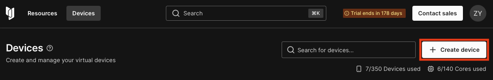
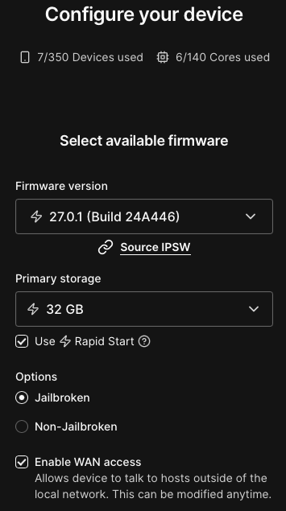
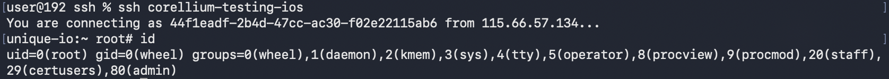
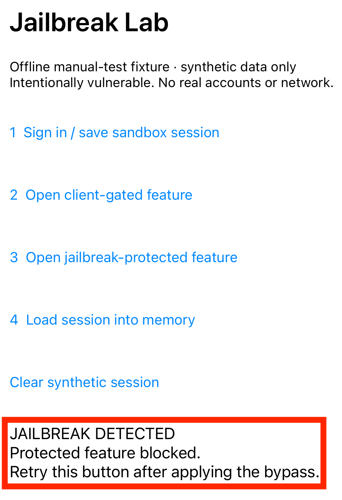
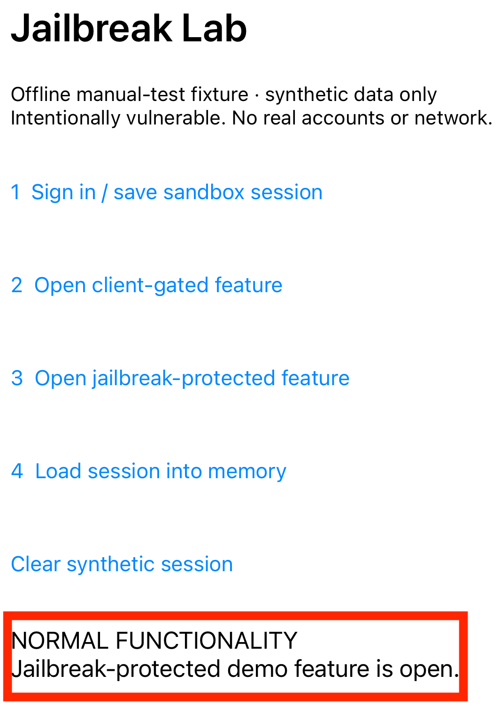

## ios-platform-feature-05-risk-03

### Title

Bypass jailbreak detection

### Description

Bypass jailbreak detection by hooking the checks the app uses to decide whether the device is jailbroken, so the app continues to run on a compromised device (MITRE ATT&CK: ***Defense Evasion*** - TA0030).

A finding means the app's jailbreak detection was defeated and the app ran normally afterwards. Detection that can be fully bypassed from a single layer offers limited protection. The finding assesses the resilience of the detection, not its presence.

### Demonstration
#### 01. Prepare the environment

Set up the required environment with:
* A Corellium virtual iPhone running a jailbroken iOS 17.6 image
* A workstation with Frida and objection installed
* A Frida server running on the Corellium device
* The target app installed on the Corellium device

#### 02. Create and boot the device

In the Corellium project, create a new device, select an iPhone model running iOS 27.0.1, and start it using the jailbroken image option so it boots with the standard restrictions removed. Creating and booting the device this way provides a controlled iOS environment with the elevated access used during testing.



*Screenshot shows creating an iPhone device and booting the jailbroken image in the Corellium project*

#### 03. Connect to the device

Connect to the device over the Corellium network and open an SSH session using the credentials shown in the device console. The connection provides a shell for running the test tooling.



*Screenshot shows an SSH session established to the device*

#### 04. Confirm elevated access

Run `id` in the SSH session and confirm the session has root privileges. Confirming elevated access establishes that the device is ready for the risks that follow.



*Screenshot shows the session running with root privileges*

#### 05. Confirm the detection behaviour

Launch the target app on the jailbroken device without any instrumentation and record what it does, such as refusing to start or showing a warning. This establishes the baseline detection behaviour to bypass.



*Screenshot shows the app blocking use on a jailbroken device*

#### 06. Attach instrumentation to the app

Start the target app under objection so the detection logic can be hooked as the app runs. Attaching gives the bypass access to the relevant checks.

``` bash
objection -g <bundle_id> explore
```

*Code block shows starting an instrumented session against the target app*

#### 07. Disable the detection

Apply the jailbreak detection bypass, which hooks common checks such as file existence, protocol handlers, and process forking. Disabling these checks prevents the app from recognising the jailbroken environment.

``` bash
ios jailbreak disable
```

*Code block shows applying the jailbreak detection bypass*

#### 08. Confirm the app now runs

Continue into the app and confirm it proceeds past the point where it previously blocked. Reaching normal app functionality confirms the detection was bypassed.



*Screenshot shows the app running normally after the bypass*

Feature-05-Risk-03 control measures:

- [ios-platform-feature-05-risk-03-control-01](ios-platform-feature-05-risk-03-control-01.md)

References:

- https://mas.owasp.org/MASTG/techniques/ios/MASTG-TECH-0087/
- https://attack.mitre.org/tactics/TA0030/
