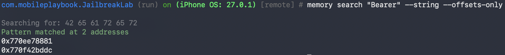
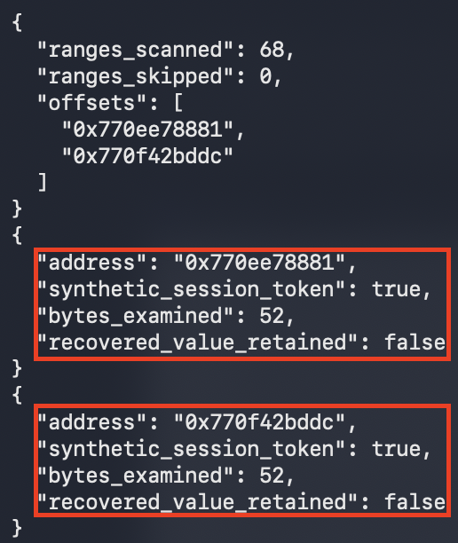

## ios-platform-feature-05-risk-04

### Title

Extract secrets from memory

### Description

Extract secrets from memory by inspecting the running app's process memory for sensitive values such as tokens or credentials (MITRE ATT&CK: ***Credential Access*** - TA0031).

A finding means sensitive values were recovered from the app's live memory. Values held in memory longer than needed widen the window in which they can be captured. The finding reflects secret lifetime and handling, not a flaw in iOS memory protection.

### Demonstration
#### 01. Prepare the environment

Set up the required environment with:
* A Corellium virtual iPhone running a jailbroken iOS 27.0.1 image, with the target app installed through the device's `Apps` tab
* A workstation with Frida and objection installed
* A Frida server running on the Corellium device


For a reproducible workflow check, use the minimal offline Jailbreak Lab 1.0 fixture, bundle `com.mobileplaybook.JailbreakLab`, saved in iOS intake. It contains only the four deliberately vulnerable test behaviors and generates synthetic session data. These demonstrations validate the procedure rather than the security of a production app. The tested tools were Frida client 17.9.10, the existing Frida server 17.19.0 and objection 1.12.4. Record versions when repeating the test.

#### 02. Create and boot the device

Reuse an existing authorised jailbroken device when it already runs iOS 27.0.1. Confirm the project, device identity, OS version and jailbroken setting before continuing. If no matching device exists, create an iPhone in Corellium, choose iOS 27.0.1 and the jailbroken option, then boot it. The screenshots below illustrate device creation; this manual test reused the existing jailbroken iPhone in the testing project.


*Screenshot shows creating an iPhone device in the Corellium project*

#### 03. Connect to the device

Open the device's `Connect` tab. Use either the Corellium VPN and device service IP, or the SSH Quick Connect command shown for this exact device. Quick Connect requires a public key already authorised for the selected project; guest authentication is separate. Use the guest credentials supplied for the test image. A project proxy accepting a key does not by itself establish a root session on the iPhone.

Over the VPN:

```bash
ssh root@<device-ip>
```

Through SSH Quick Connect:

```bash
ssh -J <project-id>@<proxy-host> root@<device-ip>
```

*Commands show connecting to the selected Corellium iPhone; copy the actual project, proxy and service IP from its Connect tab*

#### 04. Confirm elevated access

Run `id` in the SSH session and confirm the output shows `uid=0(root)`. Confirming elevated access establishes that the device is ready for the risks that follow.

```bash
id
```

*Command shows checking that the session runs with root privileges*


*Screenshot shows recorded SSH command output confirming uid=0(root); the evidence view is labelled and contains no authentication values*

#### 05. Attach to the running process

For a Corellium server reachable through SSH, keep a separate SSH forwarding session open. This binds only the workstation's loopback interface and forwards to the selected iPhone's existing Frida server:

```bash
ssh -N -L 127.0.0.1:27052:127.0.0.1:27042 -J <project-id>@<proxy-host> root@<device-ip>
```

If using the Corellium VPN, omit `-J <project-id>@<proxy-host>` from this command. Keep port 27052 and the same target device consistent in the commands that follow. Do not use an unqualified USB selector when other phones are connected.

Attach objection to the already running target through the same explicit endpoint. Use the target bundle identifier; for the fixture it is `com.mobileplaybook.JailbreakLab`. The current command spelling below avoids the deprecated `-g` and `explore` aliases accepted by objection 1.12.4.

```bash
objection -N -h 127.0.0.1 -P 27052 -n <bundle-id> start
```

*Code block shows attaching to the selected Corellium app without relying on an implicit USB device*

#### 06. Exercise the app to load secrets

Use the app so that sensitive values are loaded into memory, for example by signing in so that a session token is held. In the fixture, tap `1 Sign in / save sandbox session`, then `4 Load session into memory`. Exercising the relevant flow ensures the secrets are present to be found.

#### 07. Scan process memory

Search readable process memory for the token prefix, returning addresses only. Put the search pattern before the flags: on objection 1.12.4, putting `--string` first searches for the literal flag text instead of `Bearer`. Keep recovered bytes out of console output because objection also logs that output to disk.

``` bash
memory search "Bearer" --string --offsets-only
```

*Code block shows searching the selected process for Bearer and retaining only matching addresses*



*Screenshot shows memory addresses found by objection*

On the tested restored iOS image, objection 1.12.4 can abort with `A Frida agent exception has occurred` / `access violation` while scanning a range. That error is not a match, and an address in its stack trace is not a search result. Record the tool failure, exit objection, and attach Frida to the same running PID through the endpoint above. Run this fallback in that Frida session; it scans writable readable ranges individually and skips ranges that fault. It emits offsets and coverage counts only. Skipped ranges make the scan incomplete; no matches cannot establish that memory is free of secrets.

```javascript
var searchResult = {ranges_scanned: 0, ranges_skipped: 0, offsets: []};
Process.enumerateRanges({protection: 'rw-', coalesce: false}).forEach(function (range) {
    try {
        var matches = Memory.scanSync(range.base, range.size, '42 65 61 72 65 72');
        matches.forEach(function (match) {
            searchResult.offsets.push(match.address.toString());
        });
        searchResult.ranges_scanned++;
    } catch (error) {
        searchResult.ranges_skipped++;
    }
});
console.log(JSON.stringify(searchResult));
```

#### 08. Check for sensitive values

A prefix match alone is not evidence of a complete token. Examine only the reported target-process addresses transiently, and record the data type and address rather than the bytes. For the fixture, a 52-byte value matching `Bearer LAB-ONLY-` followed by a UUID identifies the synthetic session token. In a Frida session attached to the same PID, substitute a current match address from the successful objection search or the fallback offsets list in the check below. Never reuse addresses from an earlier run. 

```javascript
var address = ptr('<address-from-current-search>');
try {
    console.log(JSON.stringify({
        address: address.toString(),
        synthetic_session_token: /^Bearer LAB-ONLY-[A-F0-9-]{36}$/.test(address.readUtf8String(52)),
        bytes_examined: 52,
        recovered_value_retained: false
    }));
} catch (error) {
    console.log(JSON.stringify({address: address.toString(), readable: false, recovered_value_retained: false}));
}
```

*Code block checks the fixture-specific token format transiently and emits only classification metadata*

Live residency does not by itself prove the value was retained longer than necessary. Assess secret lifetime separately when testing a real app. Exit the instrumentation sessions and clear the fixture session when finished.



*Screenshot shows recorded corrected-search and guarded-fallback results from the retest*

Feature-05-Risk-04 control measures:

- [ios-platform-feature-05-risk-04-control-01](ios-platform-feature-05-risk-04-control-01.md)

References:

- https://mas.owasp.org/MASTG/techniques/ios/MASTG-TECH-0086/
- https://attack.mitre.org/tactics/TA0031/
