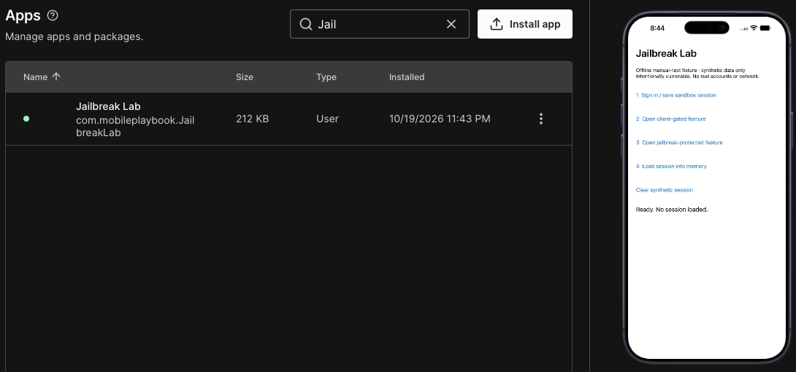

## ios-platform-feature-05

### Title

Jailbreaking an iOS device

### Description

Jailbreaking an iOS device removes the standard iOS security restrictions, granting elevated privileges and unrestricted access to the file system, running processes, and app memory. This playbook demonstrates the feature on a Corellium virtual iPhone booted with a jailbroken image instead of a physical jailbroken device, enabling authorised security testers to inspect how an application stores data, enforces decisions, and protects secrets when the device itself is compromised.

> Note: A physical jailbroken iOS device is currently not available for testing, so this playbook is demonstrated only on a Corellium virtual device.

### Demonstration
#### 01. Prepare the environment

Set up the required environment with:
* A Corellium virtual iPhone running a jailbroken iOS 27.0.1 image
* A workstation with network access to the Corellium device, through the Corellium VPN profile or the project's SSH Quick Connect
* The target app IPA available for installation


For a reproducible workflow check, use the minimal offline `Jailbreak Lab 1.0` fixture, bundle `com.mobileplaybook.JailbreakLab`, saved in sample apps. It contains only the four deliberately vulnerable test behaviours and generates synthetic session data. These demonstrations validate the procedure rather than the security of a production app. The tested tools were Frida client 17.9.10, the existing Frida server 17.19.0 and objection 1.12.4. Record versions when repeating the test.

#### 02. Create and boot the device

Reuse an existing authorised jailbroken device when it already runs iOS 27.0.1. Confirm the project, device identity, OS version and jailbroken setting before continuing. If no matching device exists, create an iPhone in Corellium, choose iOS 27.0.1 and the jailbroken option, then boot it. The screenshots below illustrate device creation; this manual test reused the existing jailbroken iPhone in the testing project.


*Screenshot shows creating a device on Corellium*


*Screenshot shows creating an iPhone device and booting the jailbroken image in the Corellium project*

#### 03. Install the target app

Open the device's `Apps` tab in Corellium, select `Install App`, and upload the target app IPA. Confirm the app appears in the installed apps list and launches on the virtual device.



*Screenshot shows the target app installed on the Corellium device*

#### 04. Connect to the device

Open the device's `Connect` tab. Use either the Corellium VPN and device service IP, or the SSH Quick Connect command shown for this exact device. Quick Connect requires a public key already authorised for the selected project; guest authentication is separate. Use the guest credentials supplied for the test image. A project proxy accepting a key does not by itself establish a root session on the iPhone.

Over the VPN:

```bash
ssh root@<device-ip>
```

Through SSH Quick Connect:

```bash
ssh -J <project-id>@<proxy-host> root@<device-ip>
```

*Commands show connecting to the selected Corellium iPhone; copy the actual project, proxy and service IP from its Connect tab*

#### 05. Confirm elevated access

Run `id` in the SSH session and confirm the output shows `uid=0(root)`. Confirming elevated access establishes that the device is ready for the risks that follow.

```bash
id
```

*Command shows checking that the session runs with root privileges*


*Screenshot shows recorded SSH command output confirming uid=0(root); the evidence view is labelled and contains no authentication values*

Because jailbreaking a device provides unrestricted access to the app and its data, your app is at risk of:

- [ios-platform-feature-05-risk-01](ios-platform-feature-05-risk-01.md)
- [ios-platform-feature-05-risk-02](ios-platform-feature-05-risk-02.md)
- [ios-platform-feature-05-risk-03](ios-platform-feature-05-risk-03.md)
- [ios-platform-feature-05-risk-04](ios-platform-feature-05-risk-04.md)
